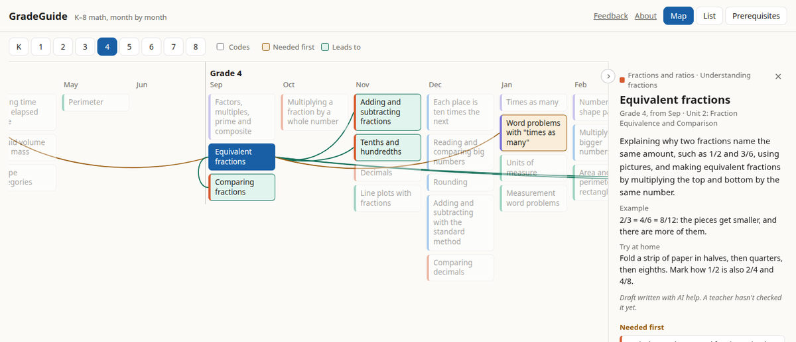
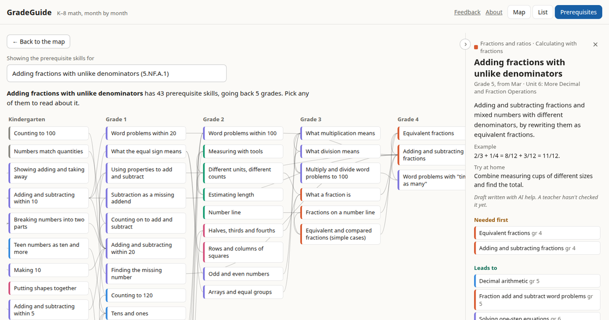
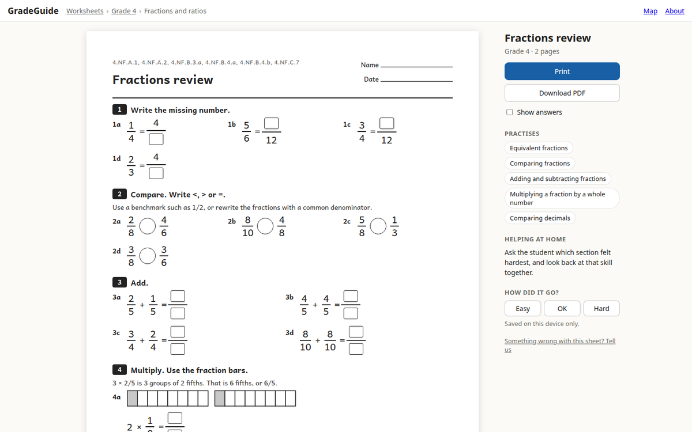
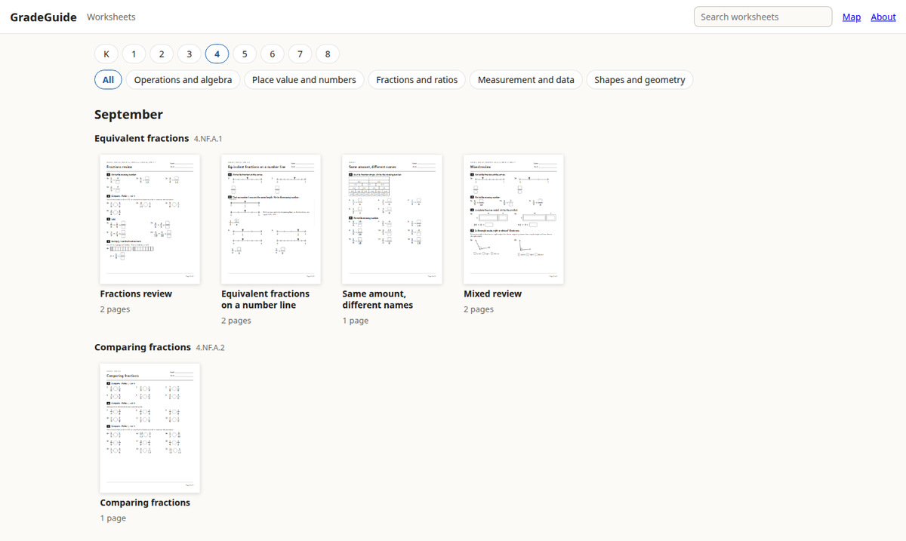
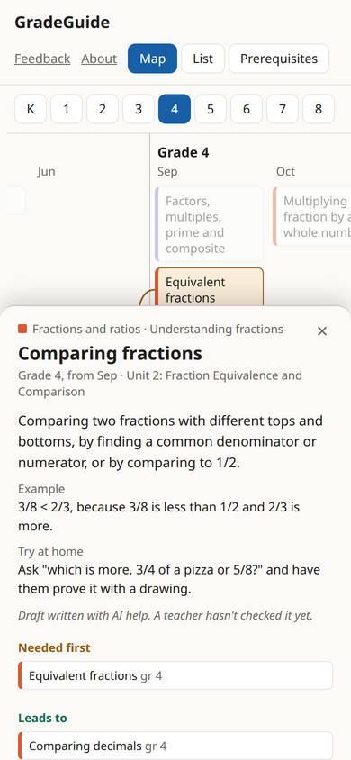

<div align="center">

# GradeGuide

**What your child learns in K–8 math, month by month, with free worksheets to print.**

[**Open GradeGuide →**](https://gradeguide.github.io/)
&nbsp;·&nbsp; [Browse worksheets](https://gradeguide.github.io/worksheets/)
&nbsp;·&nbsp; [Every skill by grade](https://gradeguide.github.io/math/)
&nbsp;·&nbsp; [Give feedback](https://github.com/gradeguide/gradeguide/issues/new/choose)

[](LICENSE)
[](content/LICENSE)
[](data/LICENSE)

<a href="https://gradeguide.github.io/#map/4/4.NF.A.1"></a>

</div>

GradeGuide is a free, open-source guide to the math a child learns from
kindergarten to grade 8. It lays each grade out as a school year, September
to June, so you can see what's being taught now, what came before, and
what's coming next. Every skill has a plain explanation, an example, an idea
to try at home, and worksheets you can print.

It's for parents and carers who want to help at home, and for teachers,
tutors and homeschoolers who want a clear map of the year. There's no
sign-up and no tracking, and it works on a phone.

## What you can do

**See the whole year.** Each grade's skills sit in the month they're usually
taught. Pick a skill to see the ones it builds on, in amber, and the ones it
leads to, in green, even across grades.

**Find out why something is hard.** The Prerequisites view shows everything a
skill rests on, back to kindergarten, so you can check the foundations when
your child is stuck.

<a href="https://gradeguide.github.io/#path/5/5.NF.A.1/5.NF.A.1"></a>

**Print a worksheet.** 175 worksheets cover nearly every K–8 skill. Each one
shows which skills it practises, has an answer key, and comes as a PDF.
Related worksheets sit below each sheet: easier ones that build up to it,
and harder ones that come next.

<p align="center">
<a href="https://gradeguide.github.io/worksheets/?only=ws-fractions-review"></a>
&nbsp;
<a href="https://gradeguide.github.io/worksheets/"></a>
</p>

**Use it anywhere.** On a phone, the map scrolls sideways and a skill's
details slide up from the bottom.

<p align="center"></p>

## Where the information comes from

Every skill is one of the
[Common Core State Standards for Mathematics](https://corestandards.org/mathematics-standards/),
which most US states have adopted or adapted.

- **What builds on what** comes from the learning progressions published by
  Student Achievement Partners.
- **The smaller steps** inside each skill come from Achievement Network.
- **When each skill is taught** follows the unit order of Illustrative
  Mathematics 360, spread over a September–June year. Your school's calendar
  may differ.
- **The explanations, examples, home ideas and worksheets** are written for
  GradeGuide with AI help. They're marked as drafts until a teacher has
  reviewed them.

The standards, progressions, steps and curriculum order reach us through the
Learning Commons Knowledge Graph, under CC BY 4.0. The
[About page](https://gradeguide.github.io/about.html) explains each source,
and [`data/CREDITS`](data/CREDITS) credits every author.

## Free to use, share and change

- **The worksheets and our own writing** are dedicated to the public domain
  under [CC0](content/LICENSE). Print them, copy them, change them and share
  them, in a classroom or anywhere else. No credit is needed.
- **The skill data** we build on is [CC BY 4.0](data/LICENSE). Credit its
  authors if you reuse it.
- **The code** is [Apache 2.0](LICENSE).

## Help make it better

- **Spotted a mistake, or have an idea?** Every page has a feedback link, or
  you can [open an issue](https://github.com/gradeguide/gradeguide/issues/new/choose).
  There are forms for a skill, a worksheet, or something that's broken.
  Issues are public, so please leave out your child's name.
- **Teachers:** the explanations and worksheets need a teacher's eye. If you
  can review a grade, open an issue and say which one.
- **Developers:** see [`docs/design.md`](docs/design.md) for how it's built,
  and [`worksheet/README.md`](worksheet/README.md) for the worksheet engine.
  Pull requests are welcome.

## For developers

GradeGuide is a static site built with [Bazel](https://bazel.build):

```bash
bazel test //...          # build everything and run the tests
bazel build //site:site   # the website, ready to serve from bazel-bin/site/site
```

The first build downloads the source skill graph, about 1 GB, pinned by
version and hash. [`docs/design.md`](docs/design.md) covers the layout, the
data pipeline, publishing and releases.
