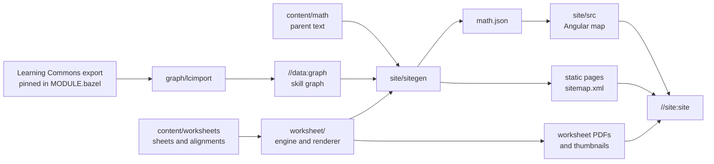

# How GradeGuide is built

GradeGuide is a static website built from three inputs: an imported skill
graph, text written for parents, and a library of worksheets. One Bazel build
turns them into the site, the data file it reads, a static page for every
skill and grade, and a PDF of every worksheet.


*Boxes are sources, programs or build outputs. Arrows show what each step reads.*

## Repository layout

| Path | What it is |
|---|---|
| `proto/graph/v1/graph.proto` | The skill graph: standards, smaller skills, prerequisites, curriculum units and lessons, and when each is taught |
| `proto/graph/v1/curated.proto` | The parent-facing layer: plain names, explanations, examples, try-at-home ideas, topics, and a review status on each |
| `proto/graph/v1/alignment.proto` | Which skills, and which smaller steps, each worksheet fragment covers |
| `content/math/` | The parent-facing text for every K–8 Common Core math standard, one file per grade |
| `content/worksheets/` | The worksheet catalogue, composed sheets and their alignments |
| `data/` | The imported skill graph build, short step names adapted from it, its licence and credits |
| `graph/lcimport/` | The importer, which turns the source export into the skill graph |
| `graph/curated/` | Loads the parent-facing layer and checks it against the graph |
| `graph/worksheets/` | Checks worksheet alignments against the graph and fills in each worksheet's header standards |
| `worksheet/` | The worksheet engine, a subproject with [its own README](../worksheet/README.md): records, composer, components, renderer and gallery |
| `site/sitegen/` | Writes `math.json`, the static skill, grade and topic pages, `sitemap.xml` and `robots.txt` |
| `site/src/` | The Angular map: the Map, List and Prerequisites views and the skill panel |
| `site/worksheets/` | The worksheet pages: the index and a page per sheet |
| `tools/bazel/` | Bazel macros for Angular components and specs |
| `.github/` | CI, the site release workflow and the feedback issue forms |

## The data pipeline

1. **Import.** `graph/lcimport` reads the pinned Learning Commons export and
   keeps K–8 Common Core math: the standards, their smaller steps (learning
   components), the prerequisite links between standards, and the Illustrative
   Mathematics 360 course structure. It works out when each standard is mainly
   taught. Every imported record keeps its source id and attribution.
2. **Curate.** `graph/curated` loads the parent-facing text in `content/math`
   and checks that every K–8 standard has an entry, and that every entry names
   a record the graph has. The build fails otherwise.
3. **Align worksheets.** Each worksheet fragment names the standards and steps
   it covers. `graph/worksheets` checks every alignment against the graph.
4. **Render.** The worksheet engine composes each sheet, and a pinned headless
   Chromium renders it as a PDF, an answer-key PDF and a page-one thumbnail.
5. **Generate the site.** `site/sitegen` writes `math.json`: each skill with
   its text, month, links, steps and worksheets. It also writes a plain HTML
   page for every skill, grade and topic, for search engines and readers
   without JavaScript.

## Building

```bash
bazel build //...
bazel test //...
```

The first build downloads the source export, about 1 GB, pinned by release
and SHA-256 in `MODULE.bazel`. To move to a new source release, change
`KNOWLEDGE_GRAPH_VERSION` and the two hashes in `MODULE.bazel`.

`//site:site` is the whole website. To look at it locally:

```bash
bazel build //site:site && python3 -m http.server 8000 --directory bazel-bin/site/site
```

## Publishing the website

The site at <https://gradeguide.github.io/> is published by a Deploy workflow
in the [gradeguide.github.io](https://github.com/gradeguide/gradeguide.github.io)
repository. Every hour it builds `//site:site` from this repository's `main`
and deploys it to GitHub Pages, if `main` has changed since the last deploy.
To deploy at once, run that workflow from its Actions tab.

## Releasing the site

Apps that work offline bundle the built website from a release. Push a tag
such as `v2026.11.12`, or run the Release workflow with a new tag, and it
attaches `gradeguide-site-<tag>.tar.gz` to a release of that name. The release
notes give its SHA-256. The archive holds what the website serves, and the
same commit always packs to the same bytes.

## Reviewing the parent-facing text

Every entry in `content/math/` starts as `STATUS_DRAFT`. A teacher who checks
an entry sets its status to `STATUS_REVIEWED`, with their name and the date,
or to `STATUS_CHANGES_REQUESTED`. Draft entries are shown with a note saying a
teacher hasn't checked them yet.

## Contributing code

Changes go through pull requests, which are squash-merged. The `bazel` check,
which runs `bazel build //...` and `bazel test //...`, must pass. Pull requests
that change the site should include screenshots.

## Licences

| Directory | Licence |
|---|---|
| Code, everywhere unless listed below | Apache License 2.0 (`LICENSE`) |
| `content/` | CC0 1.0 Universal (`content/LICENSE`) |
| `data/`, and the skill graph it builds | CC BY 4.0 (`data/LICENSE`); credits in `data/CREDITS` |

Text that comes from the imported data, or is paraphrased from it, goes in
`data/`, not in `content/`.
